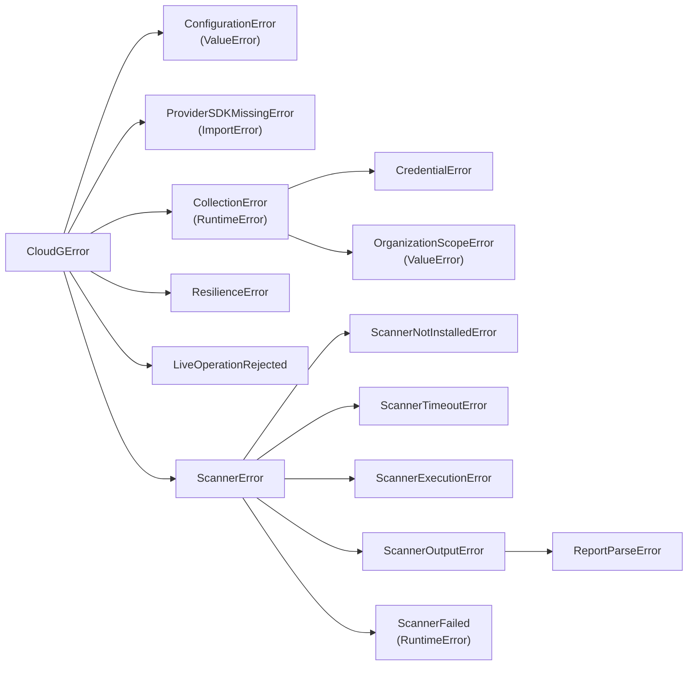
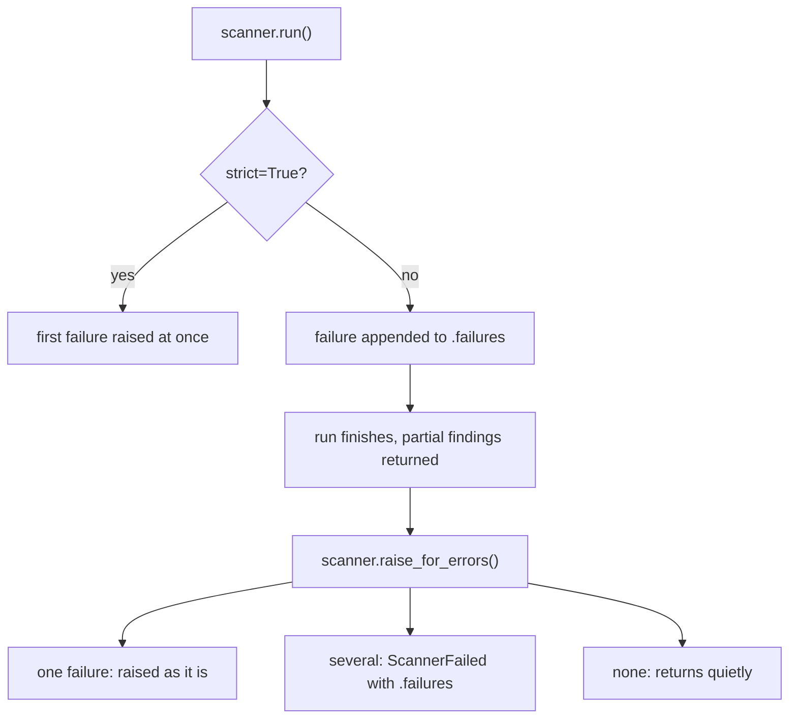

Every exception cloudg raises on purpose lives in `cloudg.exceptions` and derives from `CloudGError`, so one `except CloudGError` catches anything cloudg itself raised. Errors from the cloud SDKs and the operating system pass through untouched.
{ .lede }

**Module** `cloudg.exceptions` &middot; **Also exported from** `cloudg` &middot; **Last changed** [v0.6.1](../changelog.md#0.6.1)
{ .page-meta }

## The class tree

The narrower classes keep the built-in base they always had, so code written against an older release still works: `ProviderSDKMissingError` is still an `ImportError`, `CredentialError` is still a `RuntimeError`, and `ConfigurationError` is still a `ValueError`.


The built-in base each class keeps is in brackets.
{ .diagram-caption }

`ResilienceError` and `LiveOperationRejected` live in `cloudg.resilience`, next to their subclasses (`CircuitOpenError`, `DeadlineExceededError`, `RetryBudgetExhaustedError`, `CooldownActive`, `LiveOperationBusy`, `CallerQuotaExceeded`, `LiveOperationTimeout`). [cloudg.resilience](resilience.md) covers them. Everything else imports from `cloudg.exceptions` or straight from `cloudg`:

```python
from cloudg import CloudGError, ScannerError
from cloudg.exceptions import OrganizationScopeError, ScannerTimeoutError
from cloudg.resilience import CircuitOpenError, LiveOperationRejected
```

## When each one is raised

| Exception | Raised when | Useful attributes |
|---|---|---|
| `ConfigurationError` | A configuration value is missing, malformed or contradicts another. `cloudg.ingest.parse_report()` raises it for a tool name it does not support. | |
| `ProviderSDKMissingError` | A provider SDK is not installed: boto3 for AWS, azure-identity for Azure, google-auth or google-cloud-asset for GCP. The message names the pip extra. | `provider`, `extra`, `missing` |
| `CollectionError` | Collecting from a provider failed as a whole, for example when GCP rejects both ListAssets and SearchAllResources for a scope. | |
| `CredentialError` | Role assumption (`AssumeRole`, `AssumeRoleWithWebIdentity`) failed, no credentials resolved for `aws.role_arn`, or an account was asked for without a role to reach it. | `provider`, `detail` |
| `OrganizationScopeError` | An `--ou` (`aws.organization.include_ous`) filter matches nothing in the organization. cloudg stops instead of quietly mapping only the caller's account. | |
| `ScannerNotInstalledError` | A scanner wrapper in strict mode finds no executable on `PATH`. | `executable`, `install_hint` |
| `ScannerTimeoutError` | A scanner ran longer than `timeout_seconds` and was killed. | `timeout_seconds`, `target` |
| `ScannerExecutionError` | A scanner process could not be started, or crashed. | `returncode`, `output`, `target` |
| `ScannerOutputError` | A scanner ran, but its output could not be read or parsed. | `path` |
| `ReportParseError` | A report handed to a wrapper's `parse_report(path, strict=True)` is unreadable, or a directory holds no report. | `path` |
| `ScannerFailed` | A scanner did not finish, as reported by `CloudGEngine.scan()` through `on_error`, or by `raise_for_errors()` when a wrapper recorded several failures. | `findings`, `errors`, `failures` |

Every `ScannerError` also carries `scanner` (the wrapper's short name, such as `"checkov"`), `detail` (the reason in a few words) and `target` (the image, directory or file being scanned, when there is one). `str(exc)` is `"<scanner>: <detail>"`.

## Recorded failures and strict mode

The scanner wrappers record failures instead of raising them, so one broken scanner never stops a pipeline. Each wrapper keeps two lists:

- `errors`: why the last run did not finish (timeouts, launch failures), as text;
- `failures`: every `ScannerError` the wrapper met, including output it could not parse. Unparseable output does not stop a run, so it is in `failures` but not in `errors`.

There are two ways to turn those records into exceptions:



A missing executable is a warning by default and is not recorded as a failure, because "Trivy is not installed" is a setup choice rather than a broken run. Pass `strict=True` to get a `ScannerNotInstalledError` instead.

## Examples

Each tab is a complete script. They run without cloud credentials: with no scanner installed, the strict scanner prints the install hint, and the report parser needs only a file.

=== "strict=True"

    The first failure is raised as soon as it happens, so the `except` clauses read like an ordinary call.

    ```python title="strict_scanner.py"
    --8<-- "errors/strict_scanner.py"
    ```

    Without Checkov on `PATH` it prints:

    ```console
    $ python strict_scanner.py
    checkov is missing. pip install checkov
    ```

=== "raise_for_errors()"

    Run everything first and keep the partial results, then decide what counts as a failure.

    ```python title="raise_for_errors.py"
    --8<-- "errors/raise_for_errors.py"
    ```

    With a `trivy` on `PATH` that prints something other than JSON, both images fail to parse, so the two failures come back together as one `ScannerFailed`:

    ```console
    $ python raise_for_errors.py
    0 findings, 2 failures recorded
     - ScannerOutputError output for nginx:1.27 is not JSON: Expecting value: line 1 column 1 (char 0)
     - ScannerOutputError output for python:3.12-slim is not JSON: Expecting value: line 1 column 1 (char 0)
    failed: trivy: output for nginx:1.27 is not JSON: Expecting value: line 1 column 1 (char 0)
    failed: trivy: output for python:3.12-slim is not JSON: Expecting value: line 1 column 1 (char 0)
    ```

=== "Around CloudGEngine"

    `CloudGEngine` reports failures instead of raising them: `collect()` records them per service in the coverage records, and scanner failures reach the `on_error` hook as exception objects. A missing SDK or a refused role is easiest to catch before the run, by building the session yourself.

    ```python title="engine_errors.py"
    --8<-- "errors/engine_errors.py"
    ```

    Without boto3 it stops at the first check:

    ```console
    $ python engine_errors.py
    boto3 is not installed: pip install 'cloudg[aws]'
    ```

    `build_aws_session()` only contacts AWS when it has a role to assume, so a wrong key surfaces later, as failed services in `result.coverage` and lines in `result.errors`.

=== "parse_report(path, strict=True)"

    Each scanner wrapper has a `parse_report` class method for output that already exists. With `strict=True`, a file that is not a report raises `ReportParseError` instead of being skipped with a warning.

    ```python title="strict_parse_report.py"
    --8<-- "errors/strict_parse_report.py"
    ```

    ```console
    $ echo "not json" > results_json.json
    $ python strict_parse_report.py results_json.json
    checkov report results_json.json is unreadable: output is not JSON: Expecting value: line 1 column 1 (char 0)
    ```

    `cloudg.ingest.parse_report(tool, path)`, the function behind `cloudg ingest`, has no `strict` flag: it logs and skips unreadable files, and raises `ConfigurationError` (a `ValueError`) for an unknown tool and `FileNotFoundError` for a missing path. Call the wrapper's own `parse_report` when a bad file should stop the job.

## Catching everything cloudg raises

```python title="catch_all.py"
from cloudg import CloudGError
from cloudg.ingest import parse_report

try:
    findings = parse_report("trivvy", "./trivy.json")
except CloudGError as exc:
    print("cloudg refused:", exc)
except FileNotFoundError as exc:
    print("no such report:", exc)
```

```console
$ python catch_all.py
cloudg refused: Unsupported tool 'trivvy'. Supported: prowler, scoutsuite, checkov, trivy
```

The misspelt tool name raises `ConfigurationError`, which the first clause catches. A missing file raises the built-in `FileNotFoundError`, which is not a `CloudGError`: `except CloudGError` never hides an operating system error, an SDK exception or a bug in your own code.

## Reference

::: cloudg.exceptions
    options:
      show_root_heading: false
      show_source: true
      members_order: source

## Related

<div class="grid cards link-cards" markdown>

-   [**cloudg.resilience**](resilience.md)

    The rate limiter, circuit breakers and the errors they raise.

-   [**parse_report**](parse-report.md)

    Turning existing scanner output into findings.

-   [**Event hooks**](event-hooks.md)

    `on_error` and the other callbacks on `CloudGEngine`.

-   [**Running scanners**](../guides/running-scanners.md)

    What each scanner needs and how failures show up on the CLI.

</div>
