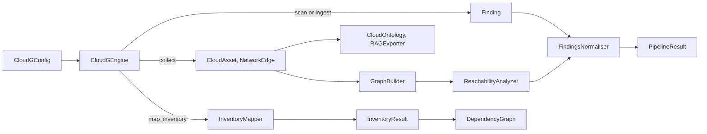

cloudg is a library first. The CLI is a thin layer over `CloudGEngine`, so anything a command does you can do from Python, one phase at a time if you like.
{ .lede }

**Package** `cloudg` &middot; **Python** 3.11 or newer &middot; **Install** `pip install cloudg`
{ .page-meta }

## Start here

Most programs need three names, all importable from the package root: `CloudGConfig` to say what to collect, `CloudGEngine` to run it, and the result object that comes back.

=== "Ingest existing reports"

    No credentials and no scanner binaries: point the engine at scanner output produced elsewhere.

    ```python title="ingest_only.py"
    from cloudg import CloudGConfig, CloudGEngine

    engine = CloudGEngine(CloudGConfig())
    result = engine.run_from_reports_sync(
        {"trivy": ["./trivy.json"], "checkov": ["./results_json.json"]},
        output_dir="./reports",
    )

    print(result.total_findings, result.severity_breakdown)
    for f in result.findings:
        print(f.severity.value, f.source_tool, f.title)
    ```

=== "Map an account"

    Read-only credentials and the `aws` extra. No scanner runs.

    ```python title="map_account.py"
    from cloudg import CloudGConfig, CloudGEngine

    config = CloudGConfig(providers=["aws"])
    config.aws.profile = "audit"
    config.aws.regions = ["ALL"]

    inventory = CloudGEngine(config).map_inventory_sync(output_dir="./reports")
    print(inventory.summary["total_assets"], "assets")
    print(inventory.summary["internet_exposed"], "internet-exposed")
    ```

=== "Full pipeline"

    What `cloudg run` does: collect, scan, analyse and report.

    ```python title="pipeline.py"
    import asyncio

    from cloudg import CloudGConfig, CloudGEngine


    async def main() -> None:
        config = CloudGConfig(providers=["aws"])
        config.scanners.enabled = ["prowler"]
        result = await CloudGEngine(config).run_pipeline(output_dir="./reports")
        print(result.to_summary())


    asyncio.run(main())
    ```

## How the pieces fit



Each box is a page below. The engine wires them together, but every one of them also works on its own: build a graph from assets you loaded yourself, normalise findings from a CMDB export, or link assets that came from your own collector.

## Reference

### Engine

<div class="grid cards link-cards" markdown>

-   [**CloudGEngine**](cloudgengine.md)

    The engine behind `cloudg run`, `cloudg ingest` and `cloudg map`: the whole pipeline in one call, or each phase yourself.

-   [**CloudGConfig**](cloudgconfig.md)

    The pydantic model behind `config.yaml`. Build it in code, load it from a file, or both.

-   [**Result objects**](results.md)

    `PipelineResult`, `CollectionResult` and `AnalysisResult`: what the engine hands back.

-   [**Event hooks**](event-hooks.md)

    Six optional callbacks that report phases, findings, results and failures during a run.

-   [**Exceptions**](exceptions.md)

    The `CloudGError` hierarchy, strict mode for the scanner wrappers and `raise_for_errors()`.

</div>

### Inventory

<div class="grid cards link-cards" markdown>

-   [**InventoryMapper**](inventorymapper.md)

    Maps what is deployed and how it connects, then overlays scanner findings on the map.

-   [**InventoryResult**](inventoryresult.md)

    The map as one object: assets, edges, summary, dependency analysis, save and load.

-   [**RelationshipLinker**](relationshiplinker.md)

    Turns a flat list of assets from any source into a connected map.

-   [**DependencyGraph**](dependencygraph.md)

    What an asset needs, and what breaks if it goes away.

</div>

### Graph

<div class="grid cards link-cards" markdown>

-   [**GraphBuilder**](graphbuilder.md)

    Assets and edges as a NetworkX `DiGraph`: attack paths, centrality, exports.

-   [**ReachabilityAnalyzer**](reachabilityanalyzer.md)

    What the internet can reach, along the edges traffic can actually take.

-   [**CloudOntology**](cloudontology.md)

    An rdflib graph with 64 typed relations, exported as RDF and queried with SPARQL.

-   [**RAGExporter**](ragexporter.md)

    Text chunks with metadata, ready to embed for retrieval-augmented generation.

</div>

### Findings

<div class="grid cards link-cards" markdown>

-   [**FindingsNormaliser**](findingsnormaliser.md)

    Findings from any number of scanners, merged, rescored, sorted and mapped to controls.

-   [**parse_report**](parse-report.md)

    Native Prowler, ScoutSuite, Checkov and Trivy output as `Finding` objects.

-   [**Data models**](models.md)

    The pydantic models every part of cloudg exchanges.

</div>

### Extend

<div class="grid cards link-cards" markdown>

-   [**Entry points**](entry-points.md)

    Ship a collector or a scanner as its own package; `PluginRegistry` finds it.

-   [**cloudg.resilience**](resilience.md)

    Your own cloud API calls through cloudg's rate limits, circuit breakers and retry budget.

-   [**CloudGMCPLayer**](mcp-layer.md)

    The MCP catalog as a Python object: call it in-process, mount it, or export it.

</div>

## Conventions

- Signatures, parameter tables and the "source" links on these pages are generated from the code at build time, so they always match the release the site was built from. The prose and the examples above each reference are written by hand.
- Methods that end in `_sync` wrap the async method of the same name in `asyncio.run()`. Use them from scripts; inside a running event loop, `await` the async method.
- Everything cloudg raises on purpose derives from `CloudGError`. See [Exceptions](exceptions.md).
