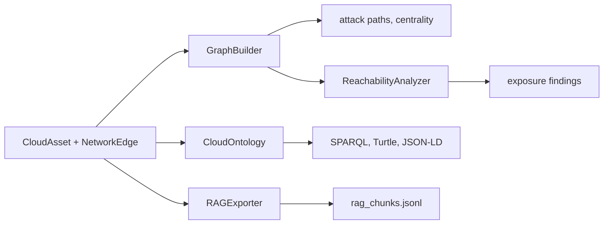

The graph, the ontology and the RAG export all start from the same two lists, `CloudAsset` and `NetworkEdge`. These scripts build a small estate by hand, so every one of them is **offline**: swap the hand-made lists for `collection.assets` and `collection.edges` from `CloudGEngine.collect()`, or for an `InventoryResult` you loaded, and nothing else changes.
{ .lede }



## Build and explore the graph

`GraphBuilder` turns the lists into a NetworkX `DiGraph`, merges parallel rules between the same pair of nodes, and adds a placeholder node for `0.0.0.0/0`.

=== "Python"

    ```python title="build_graph.py"
    --8<-- "graph/build_graph.py"
    ```

=== "Output"

    ```console
    $ python build_graph.py
    9 nodes, 10 edges from 11 NetworkEdges
    merged rule: 443,80 | HTTPS from anywhere; HTTP redirect
    placeholder: EXTERNAL True
    internet path: 0.0.0.0/0 -> sg-alb -> sg-web
    identity path: web-1 -> app-role -> orders-db
    lateral path: web-1 -> app-role
    betweenness 0.080  web-1
    betweenness 0.071  web-tg
    betweenness 0.054  app-role
    community 0: ['0.0.0.0/0', 'sg-alb']
    community 1: ['sg-web', 'web-2']
    community 2: ['app-role', 'orders-db', 'web-1']
    community 3: ['web-alb', 'web-tg']
    wrote ['estate-cytoscape.json', 'estate-d3.json', 'estate.graphml']
    ```

=== "CLI"

    `cloudg run` builds the same graph from a live collection and writes it next to the reports:

    ```bash
    cloudg run -p aws --regions eu-west-1 -o ./reports
    ls reports/topology.graphml
    ```

    `graph.persist_graphml` (on by default) writes `topology.graphml`, and `graph.export_cytoscape` (off by default) adds `topology-cytoscape.json`. Both are in the [graph section](../reference/config/graph.md) of config.yaml.

## What can the internet reach

`ReachabilityAnalyzer` walks the graph from the internet along the edges traffic can actually take, and gives each finding an id that stays the same from run to run.

=== "Python"

    ```python title="exposure.py"
    --8<-- "graph/exposure.py"
    ```

=== "Output"

    ```console
    $ python exposure.py
    entry points: ['0.0.0.0/0']
    exposed: ['orders-api', 'sg-alb', 'sg-web', 'web-1', 'web-alb', 'web-tg']
    hops out of sg-web:
      -> web-1 via ATTACHED_TO (reversed)
    HIGH     Unexpected internet-exposed resource: orders-api  id=b5fbe235
    HIGH     Unexpected internet-exposed resource: web-1  id=4ec3a339
    CRITICAL Security group allows SSH (port 22) from 0.0.0.0/0  id=17cd5168
    web-1 exposure id: 4ec3a339
    flow edges: 10 of 14
    flow reversed: [('sg-alb', 'web-alb'), ('sg-db', 'orders-db'), ('sg-web', 'web-1')]
    blast radius of web-1: ['0.0.0.0/0', 'app-role', 'orders-db', 'sg-db', 'sg-web'] depth 3 risk 4.5
    ```

## Query it with SPARQL

`CloudOntology` writes the estate into an rdflib graph with typed relations, then exports it in four RDF serialisations and answers SPARQL queries.

=== "Python"

    ```python title="ontology_demo.py"
    --8<-- "graph/ontology_demo.py"
    ```

=== "Output"

    ```console
    $ python ontology_demo.py
    689 triples, 9 classes, 9 individuals
    groups: {'GOVERNANCE': 2, 'NETWORK': 3, 'SECURITY': 4}
      0.0.0.0/0 INGRESS_ALLOWED sg-web
      0.0.0.0/0 INTERNET_REACHABLE sg-web
      0.0.0.0/0 ONLY_SSH sg-web
      RDS instance has no deletion protection FINDING_AFFECTS orders-db
      orders-db ENCRYPTED_BY_KMS orders-key
      web-1 OWNED_BY https://cloudg.io/resource/tag_payments
      web-1 PROTECTED_BY_SG sg-web
      web-1 TAGGED_WITH https://cloudg.io/resource/tag_owner_payments
    internet reachable: ['sg-web']
    security group: 4 triples
    compliance gaps: [('HIGH', 'orders-db')]
    reloaded 689 triples from ['ontology.jsonld', 'ontology.nt', 'ontology.rdf', 'ontology.ttl']
    ```

## Chunks for retrieval-augmented generation

`RAGExporter` cuts the estate into one chunk per asset, per community and per relation group, each with metadata you can filter on before a similarity search.

=== "Python"

    ```python title="rag_demo.py"
    --8<-- "graph/rag_demo.py"
    ```

=== "Output"

    ```console
    $ python rag_demo.py
    {'chunks': 'rag_chunks.jsonl', 'index': 'rag_metadata_index.json'}
    {'total_chunks': 11, 'entity_chunks': 5, 'community_chunks': 2, 'relation_group_chunks': 4}
    11 records -> rag-out/vector-records.jsonl
    Resource: web-1
    Type: EC2
    Provider: AWS
    Region: eu-west-1
    ARN: arn:aws:ec2:eu-west-1:123456789012:instance/i-0web1
    Account: 123456789012
    WARNING: INTERNET EXPOSED

    Relations (2):
      -> PROTECTED_BY_SG: sg-web
      -> RUNS_ON: app-role

    Findings (1):
      [HIGH] Instance metadata service v1 enabled
    {'chunk_type': 'entity', 'asset_type': 'EC2', 'provider': 'AWS', 'region': 'eu-west-1', 'account_id': '123456789012', 'is_internet_exposed': True, 'relation_types': 'PROTECTED_BY_SG,RUNS_ON', 'severity_max': 'HIGH', 'compliance_frameworks': 'CIS', 'neighbour_count': 2, 'finding_count': 1, 'arn': 'arn:aws:ec2:eu-west-1:123456789012:instance/i-0web1'}
    high or critical: ['entity::web-1', 'community::1']
    ```

=== "config.yaml"

    `cloudg run` writes the ontology and the chunks when these are on:

    ```yaml title="config.yaml"
    ontology:
      enabled: true
      export_formats: [turtle, json-ld]
    rag:
      enabled: true
      chunk_strategy: hybrid
      max_chunk_tokens: 2000
    ```

## Related

<div class="grid cards link-cards" markdown>

-   [**Graph, ontology and RAG**](../guides/graph-ontology-rag.md)

    The guide: what each export contains and how to load it elsewhere.

-   [**GraphBuilder**](../api/graphbuilder.md)

    Every method, from `build()` to `save_graphml()`.

-   [**CloudOntology**](../api/cloudontology.md)

    The relations, the query helpers and the serialisations.

-   [**RAGExporter**](../api/ragexporter.md)

    Chunk types, metadata fields and size limits.

</div>
