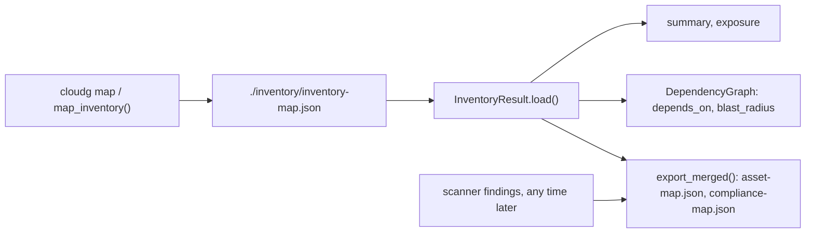

Map an account once, then ask questions of the saved map as often as you like: what faces the internet, what depends on a key, what breaks if a queue goes away.
{ .lede }



## Map an account

Needs read-only AWS credentials and `pip install "cloudg[aws]"`. No scanner runs.

=== "CLI"

    ```bash
    cloudg map -p aws --regions all --no-sweep -o ./inventory
    ```

=== "Python"

    ```python title="map_only.py"
    --8<-- "map/map_only.py"
    ```

=== "Docker"

    ```bash
    docker run --rm \
      -v ~/.aws:/home/cloudg/.aws:ro \
      -v "$PWD/inventory:/app/reports" \
      ghcr.io/morpheuslord/cloudg:latest \
      map -p aws --regions all --no-sweep
    ```

`tagging_sweep=False` and `--no-sweep` both skip the Resource Groups Tagging API sweep. [InventoryMapper](../api/inventorymapper.md) has the other switches and [Inventory mapping](../guides/inventory-mapping.md) explains what each layer collects.

## Save, load and summarise a map

**Offline.** An `InventoryResult` built from hand-made assets, exported to disk and loaded back. The same `load()` reads a map that `cloudg map` wrote.

=== "Python"

    ```python title="inventory_roundtrip.py"
    --8<-- "map/inventory_roundtrip.py"
    ```

=== "Output"

    ```console
    $ python inventory_roundtrip.py
    ['dependencies', 'graph', 'graphml', 'map']
    5 6 {'INVOKES': 1, 'REFERENCES': 4, 'ASSUMES_ROLE': 1}
    external accounts: 1 cross-account edges: 1
    ['shared_dependencies', 'largest_blast_radius', 'cross_account_edges', 'security_coverage', 'unresolved_references']
    [('orders-key', 3)]
    [{'source': 'arn:aws:lambda:eu-west-1:123456789012:function:orders-worker', 'source_account': '123456789012', 'target': 'arn:aws:iam::999999999999:root', 'target_account': '999999999999', 'edge_type': 'ASSUMES_ROLE', 'relationship': None, 'external': True}]
    ```

Then read the saved map without calling the cloud:

```python title="whats_exposed.py"
--8<-- "map/whats_exposed.py"
```

## What breaks if this goes away

**Offline.** The script builds its assets by hand. `DependencyGraph` answers "what does this need" and "what needs this", with the edge each step follows.

=== "CLI"

    Against the map `inventory_roundtrip.py` saved in `./inventory`:

    ```bash
    cloudg deps orders-key --direction down --map ./inventory
    cloudg deps orders-worker --direction up --map ./inventory
    ```

=== "Python"

    ```python title="blast_radius.py"
    --8<-- "map/blast_radius.py"
    ```

=== "Output"

    ```console
    $ python blast_radius.py
    If orders-key is disabled:
      depth 1: orders-inbound (MESSAGE_QUEUE) needs orders-key via REFERENCES
      depth 1: orders (DYNAMODB_TABLE) needs orders-key via REFERENCES
      depth 2: orders-worker (LAMBDA_FUNCTION) needs orders-inbound via INVOKES
    orders-worker needs: ['orders-worker-role', 'orders', 'orders-inbound', 'orders-api', 'orders-key']
    direct (needs, needed by): (4, 0)
    orders-key           3 dependents, 0 internet-exposed
    orders-api           1 dependents, 0 internet-exposed
    orders               1 dependents, 0 internet-exposed
    ```

[Dependencies and blast radius](../guides/dependencies.md) explains how direction works and how to read the tables `cloudg deps` prints.

## Overlay findings on a saved map

Scanner findings can arrive days after the map. Load both and write the overlay next to the map. The script reads the map in `./inventory` (from `inventory_roundtrip.py` above, or `cloudg map -o ./inventory`) and the sample reports: run [`make_sample_reports.py`](index.md#sample-reports-to-work-with) in the same directory first, and copy its `trivy-image.json` to `trivy.json`.

=== "CLI"

    ```bash
    cloudg map -p aws --regions all -o ./inventory --findings ./reports/raw-findings.json
    ```

    On the CLI the flag belongs to `cloudg map`, so it maps again. The Python call reuses the saved map.

=== "Python"

    ```python title="overlay_findings.py"
    --8<-- "map/overlay_findings.py"
    ```

=== "Output"

    ```console
    $ python overlay_findings.py
    {'asset_map': 'inventory/asset-map.json', 'compliance_map': 'inventory/compliance-map.json'}
    CIS 1 ['arn:aws:s3:::my-bucket']
    CVE 1 ['myrepo/app:latest']
    GDPR-AWS 1 ['arn:aws:s3:::my-bucket']
    5 assets, 0 with findings
    ```

The sample findings name resources that are not on this map, so no asset picks one up, but the compliance map still lists every affected resource. Against a map of the account the scanners looked at, each asset in `asset-map.json` carries its own findings.

## Related

<div class="grid cards link-cards" markdown>

-   [**InventoryResult**](../api/inventoryresult.md)

    Every field and method of the saved map.

-   [**DependencyGraph**](../api/dependencygraph.md)

    `depends_on`, `dependents`, `tree`, `blast_radius` and the asset matcher.

-   [**cloudg deps**](../cli/deps.md)

    The same questions from the command line.

-   [**Inventory structures**](../reference/inventory/index.md)

    Every file the map writes, field by field.

</div>
