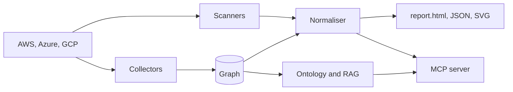

<div class="cg-hero" markdown>
<div class="cg-hero-text" markdown>
<span class="cg-kicker">Cloud graphing for AWS, Azure and GCP</span>

<h1>Map the cloud. Scan it. Merge everything.</h1>

cloudg collects your infrastructure into a graph, runs the security scanners you already trust over the same accounts and merges every finding against 28 compliance frameworks. You can also skip scanning entirely and just map what you have.
{ .lede }

[Get started](guides/quickstart.md){ .md-button .md-button--primary }
[Python API](api/index.md){ .md-button }
[Sample report](sample-report.md){ .md-button }

```bash
pip install "cloudg[aws]"
```
</div>
<figure class="cg-hero-art" aria-label="An example map: an internet-facing load balancer, the instances behind it, their database, role and bucket">
<svg class="hero-graph" viewBox="-60 10 660 420" role="img" aria-hidden="true">
<path class="hg-cloud" d="M118 128a26 26 0 0 1-2-52a34 34 0 0 1 64-12a28 28 0 0 1 38 26a22 22 0 0 1-4 38z" transform="translate(-300 -120) scale(4)"/>
<g class="hg-edges">
<line x1="250" y1="240" x2="380" y2="330"/>
<line x1="250" y1="350" x2="380" y2="330"/>
<line x1="250" y1="240" x2="380" y2="220"/>
<line x1="380" y1="220" x2="490" y2="250"/>
<line x1="490" y1="250" x2="330" y2="125"/>
<line x1="330" y1="125" x2="380" y2="220"/>
<line x1="380" y1="330" x2="490" y2="340"/>
<line class="hg-dash" x1="150" y1="200" x2="130" y2="300"/>
<line class="hg-dash" x1="150" y1="200" x2="250" y2="240"/>
<line class="hg-dash" x1="150" y1="200" x2="250" y2="350"/>
</g>
<g class="hg-hot">
<line x1="-10" y1="300" x2="130" y2="300"/>
<line x1="130" y1="300" x2="250" y2="240"/>
<line x1="130" y1="300" x2="250" y2="350"/>
</g>
<g class="hg-elabel">
<text x="262" y="214">ASSUMES_ROLE</text>
<text x="428" y="225">GRANTS_ACCESS</text>
<text x="398" y="178">INVOKES</text>
<text x="58" y="262">PROTECTS</text>
<text x="-6" y="290" class="hg-hot-t">INTERNET_EXPOSED</text>
</g>
<g class="hg-nodes">
<rect x="-18" y="292" width="16" height="16" class="hg-red"/>
<circle cx="130" cy="300" r="9" class="hg-red"/>
<circle cx="250" cy="240" r="9"/>
<circle cx="250" cy="350" r="9"/>
<rect x="143" y="193" width="14" height="14"/>
<circle cx="380" cy="330" r="9"/>
<rect x="373" y="213" width="14" height="14"/>
<circle cx="490" cy="250" r="9"/>
<circle cx="330" cy="125" r="9"/>
<rect x="483" y="333" width="14" height="14"/>
</g>
<g class="hg-labels">
<text x="-30" y="330">0.0.0.0/0</text>
<text x="104" y="328">alb/web</text>
<text x="222" y="270">i-web-1</text>
<text x="222" y="380">i-web-2</text>
<text x="96" y="190">sg-web</text>
<text x="350" y="360">rds/orders</text>
<text x="352" y="252">role/app</text>
<text x="470" y="280">s3/assets</text>
<text x="300" y="155">fn/resize</text>
<text x="466" y="370">kms/data</text>
</g>
</svg>
<figcaption>An example map. Red marks the path in from the internet.</figcaption>
</figure>
</div>

<!-- cloudg:stats -->

## Three ways in

<div class="grid cards" markdown>

-   <span class="cg-num">01 &middot; full pipeline</span>

    **Collect, scan, report**

    ---

    Every provider in parallel, all four scanners and every report format, in one command.

    ```bash
    cloudg run -p all --regions all
    ```

    [:octicons-arrow-right-24: The pipeline](guides/pipeline.md)

-   <span class="cg-num">02 &middot; ingest only</span>

    **Merge output you already have**

    ---

    No cloud credentials and no scanner binaries. Point it at the files and get the same reports.

    ```bash
    cloudg ingest --prowler ./out/
    ```

    [:octicons-arrow-right-24: Ingesting existing output](guides/ingesting.md)

-   <span class="cg-num">03 &middot; map only</span>

    **Inventory, every service linked**

    ---

    Typed edges such as `INVOKES`, `ASSUMES_ROLE` and `PROTECTS`, with no scanner involved.

    ```bash
    cloudg map -p aws --org
    ```

    [:octicons-arrow-right-24: Inventory mapping](guides/inventory-mapping.md)

</div>

## The same run from Python

The CLI is a thin layer over `CloudGEngine`, so anything a command does you can do from Python, one phase at a time if you like.

=== "CLI"

    ```bash
    cloudg ingest --prowler ./prowler-output/ --trivy ./trivy.json -o ./reports
    ```

=== "Python"

    ```python title="ingest.py"
    from cloudg import CloudGConfig, CloudGEngine

    engine = CloudGEngine(CloudGConfig())
    result = engine.run_from_reports_sync(
        {"prowler": ["./prowler-output/"], "trivy": ["./trivy.json"]},
        output_dir="./reports",
    )
    print(result.total_findings, result.severity_breakdown)
    print(result.report_paths)  # findings.json and report.html
    ```

=== "Docker"

    ```bash
    docker run --rm \
      -v "$PWD:/app/input:ro" \
      -v "$PWD/reports:/app/reports" \
      ghcr.io/morpheuslord/cloudg:latest \
      ingest --prowler /app/input/prowler-output/ --trivy /app/input/trivy.json
    ```

## What happens in a run

Collectors read each provider concurrently and hand assets and edges to a NetworkX graph. Scanners run in parallel against the same accounts, and their output is normalised into one finding model, deduplicated and matched to compliance controls. The same data then leaves as an HTML report, JSON, GraphML, an RDF ontology, RAG chunks and, if you want it, an MCP server for your AI assistant.



## Where to go next

<div class="grid cards" markdown>

-   :material-book-open-variant:{ .lg .middle } **Guides**

    ---

    Install, authenticate, map an account, run the scanners and read the report.

    [:octicons-arrow-right-24: Introduction](guides/introduction.md)

-   :material-console:{ .lg .middle } **CLI reference**

    ---

    Every command and every flag, generated from the click definitions so it matches `--help`.

    [:octicons-arrow-right-24: All commands](cli/index.md)

-   :material-language-python:{ .lg .middle } **Python API**

    ---

    `CloudGEngine` and the modules behind it, with signatures, parameters and runnable examples.

    [:octicons-arrow-right-24: Python API](api/index.md)

-   :material-code-tags:{ .lg .middle } **Examples**

    ---

    Complete scripts for mapping, ingesting, graph exports and error handling, each with its output.

    [:octicons-arrow-right-24: Examples](examples/index.md)

-   :material-robot-outline:{ .lg .middle } **MCP server**

    ---

    74 tools for Claude Desktop, Claude Code, Cursor, VS Code or any other MCP client.

    [:octicons-arrow-right-24: MCP server](mcp/index.md)

-   :material-file-chart-outline:{ .lg .middle } **Sample report**

    ---

    The interactive report.html for a synthetic three-cloud estate, with no account needed.

    [:octicons-arrow-right-24: Open the sample report](sample-report.md)

</div>

<script>
  // Links into the old one-page handbook (index.html#install) go to the page that replaced the section.
  (function () {
    var map = {"install": "guides/installation/", "pipeline": "guides/pipeline/", "run": "cli/run/", "collect-scan": "cli/collect/", "map": "guides/inventory-mapping/", "deps": "guides/dependencies/", "ingest": "guides/ingesting/", "report": "cli/report/", "inputs": "guides/ingesting/#input-requirements", "outputs": "reference/output-files/", "models": "api/models/", "inventory-docs": "reference/inventory/", "config": "reference/config/providers/", "ratelimit": "guides/rate-limits/", "api": "api/", "recipes": "guides/python-recipes/", "plugins": "api/entry-points/", "auth": "guides/authentication/", "docker": "guides/docker/", "mcp": "mcp/", "mcp-serve": "cli/mcp-serve/", "mcp-embed": "mcp/server/in-process-use/", "mcp-policies": "mcp/privacy/built-in-profiles/", "mcp-catalog": "mcp/tools/tool-index/", "mcp-cli": "cli/mcp-serve/", "changelog": "changelog/"};
    var hash = location.hash.slice(1);
    if (hash && map[hash]) { location.replace(map[hash]); }
  })();
</script>
